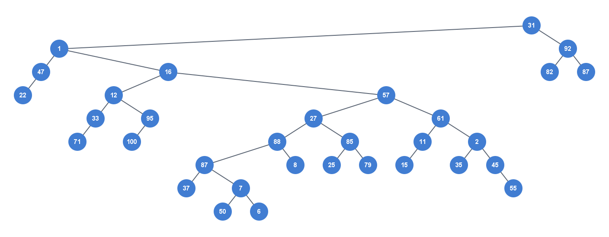

# Laboratorium 3 – drzewa binarne i dwumianowe

Dostępne są klasa `BinomialNode` (reprezentująca węzeł drzewa dwumianowego), funkcja generująca losowe drzewo binarne oraz funkcja zapisująca rysunek drzewa do pliku PNG. Pozostałe klasy i funkcje należy napisać samodzielnie.

**Ograniczenie:** w zadaniach nie wolno używać wbudowanych struktur danych Javy (`List`, `ArrayList`, `Map`, `Set`, `Stack`, `Queue` itp.). Wszystkie potrzebne struktury należy zbudować z własnych węzłów.

## Zadanie 1 – najgłębsze węzły drzewa binarnego

W programie głównym tworzone jest losowe drzewo binarne z `2^h` węzłów `BinomialNode`. Pole `prev` oznacza lewe dziecko, `next` – prawe dziecko, a `child` ma wartość `null`. Wygenerowane drzewo przedstawiono poniżej:

Znajdź największą głębokość drzewa (korzeń ma głębokość 0) i zbierz wszystkie węzły znajdujące się na tej głębokości do **własnej listy jednokierunkowej**. Wypisz tę głębokość oraz wartości wszystkich znalezionych węzłów. Puste drzewo ma głębokość `-1` i pustą listę.

## Zadanie 2 – konwersja drzewa binarnego do dwumianowego

Przekształć drzewo binarne z zadania 1, zawierające `2^h` węzłów, w drzewo dwumianowe o wysokości `h`. Nie twórz nowych węzłów ani nie zmieniaj ich wartości. Wywołaj napisaną funkcję w metodzie `main`.

**Wskazówka:** wykorzystaj rozwiązanie stosowane w funkcji `delMax` dla kopca Fibonacciego.

Drzewo po konwersji przedstawiono poniżej:

